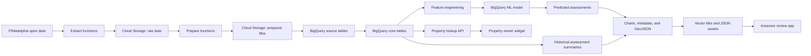

# SmartCAMA

SmartCAMA is a cloud-based, computer-assisted mass appraisal (CAMA) prototype for Philadelphia residential properties. It combines public property and parcel data with a BigQuery ML valuation model, then publishes the results through two browser-based applications:

- **Tax Assessor Review** — an interactive parcel map for comparing modeled values with official tax-year assessments, filtering by ZIP code, finding large discrepancies, and reviewing citywide value distributions.
- **Property Owner Widget** — an address search experience with property characteristics, assessment history, year-over-year changes, and land/building value breakdowns.

The project includes data-pipeline components, model SQL, map-tile generation, a lookup API, and the static front end.

> [!IMPORTANT]
> This repository is a prototype. Model predictions are not official property assessments and should not be used as a substitute for an appraisal or an assessment issued by the City of Philadelphia.

## How it works



The pipeline uses four logical storage layers:

| Layer | Purpose |
| --- | --- |
| Raw | Original downloads from the source systems. |
| Prepared | Cleaned Parquet or JSONL files used by BigQuery external tables. |
| Core | Typed, query-ready copies of the source data. |
| Derived | Training data, models, predictions, chart bins, and map-ready records. |

## Technology

- **Google Cloud Functions** for extraction, preparation, loading, transformation, asset export, and property lookup
- **Google Cloud Storage** for raw data, prepared data, temporary GeoJSON, vector tiles, and public JSON assets
- **BigQuery and BigQuery ML** for warehouse tables, feature engineering, random-forest training, and prediction
- **Google Cloud Workflows** for pipeline orchestration
- **Cloud Run Jobs** and **GDAL/OGR** for vector-tile generation
- **MapLibre GL JS** for parcel mapping
- **ApexCharts** for assessment visualizations
- **GitHub Pages** for the static front end

## Repository structure

```text
SmartCAMA/
├── .github/workflows/   # Linting and GitHub Pages deployment
├── eda/                 # Exploratory data analysis and feature notes
├── sql/model/           # Model experiments and assessment prediction SQL
├── tasks/               # Deployable cloud functions, job, and workflow
│   ├── data-pipeline/
│   ├── extract-*/
│   ├── prepare-*/
│   ├── load-*/
│   ├── transform-*/
│   ├── predict-current-assessments/
│   ├── export-*/
│   ├── generate-*/
│   └── property-lookup/
└── ui/
    ├── index.html       # Application landing page
    ├── reviewer/        # Assessor map and distribution dashboard
    └── widget/          # Public property history lookup
```

## Data sources

The core pipeline starts with these Philadelphia datasets:

| Dataset | Use in SmartCAMA |
| --- | --- |
| [Properties and Assessment History](https://opendataphilly.org/dataset/opa-property-assessments) | Property characteristics, sales, current values, and historical assessments. |
| [PWD Stormwater Billing Parcels](https://opendataphilly.org/dataset/pwd-stormwater-billing-parcels) | Parcel geometry used to build the property map. |

The extraction functions download OPA CSV files from Philadelphia's public download service and query parcel records through the Philadelphia Carto API.

## Local development

### Prerequisites

- Node.js 22 or a compatible current release
- Python 3.9 or later
- [Poetry](https://python-poetry.org/) for the Python development environment

Install the development dependencies:

```bash
npm ci
poetry install
```

### Preview the web applications

The UI is static, so it can be served with any local HTTP server:

```bash
python3 -m http.server 8000 --directory ui
```

Open `http://localhost:8000` to choose an application, or go directly to:

- `http://localhost:8000/reviewer/`
- `http://localhost:8000/widget/`

The local UI currently reads from the deployed Team 6 API and public Cloud Storage assets. An internet connection is therefore required even when the HTML, CSS, and JavaScript are served locally.

### Run quality checks

Run every configured linter:

```bash
npm run lint
```

Or run a single linter:

```bash
npm run lint-js
npm run lint-css
npm run lint-sql
npm run lint-py
```

The JavaScript, CSS, and SQL commands apply safe automatic fixes where possible. Review the resulting diff before committing.

## Data pipeline

The workflow definition is in [`tasks/data-pipeline/workflow.yaml`](tasks/data-pipeline/workflow.yaml). Its deployable components are grouped by responsibility:

1. **Extract**
   - `extract-opa-properties`
   - `extract-opa-assessments`
   - `extract-pwd-parcels`
2. **Prepare**
   - `prepare-opa-properties`
   - `prepare-opa-assessments`
   - `prepare-pwd-parcels`
3. **Load**
   - `load-opa-properties`
   - `load-opa-assessments`
   - `load-pwd-parcels`
4. **Model and transform**
   - `transform-current-assessments-model-training-data`
   - `predict-current-assessments`
   - `transform-tax-year-assessment-bins`
   - `transform-current-assessment-bins`
5. **Publish application assets**
   - `export-assessment-chart-configs`
   - `export-property-tile-info`
   - `generate-tile-style-metadata`
   - `generate-property-map-tiles`
6. **Serve property details**
   - `property-lookup`

Each Python task has its own `requirements.txt` so it can be deployed independently. SQL that belongs to a task is stored beside its Python entry point.

> [!NOTE]
> The checked-in workflow also calls a deployed `generate-assessment-bins` function whose source is not present in this repository. Remove or replace that step when creating a deployment solely from this codebase.

## Cloud resources

The checked-in deployment is configured for the Google Cloud project `musa5090s26-team6`, primarily in `us-east4`.

### Cloud Storage

| Bucket | Contents |
| --- | --- |
| `musa5090s26-team6-raw_data` | Source CSV downloads. |
| `musa5090s26-team6-prepared_data` | Prepared Parquet and JSONL files for BigQuery external tables. |
| `musa5090s26-team6-temp_data` | Intermediate GeoJSON used during vector-tile generation. |
| `musa5090s26-team6-public` | Public map tiles and UI configuration JSON. |

The public bucket is organized as follows:

```text
configs/
├── current_assessment_bins.json
├── tax_year_assessment_bins.json
└── tile_style_metadata.json
tiles/
└── {z}/{x}/{y}.pbf
```

### BigQuery

| Dataset | Important objects |
| --- | --- |
| `source` | External `opa_properties`, `opa_assessments`, and `pwd_parcels` tables backed by prepared files. |
| `core` | Typed, internal copies of the three source tables with a standardized `property_id`. |
| `derived` | Model training data, the BigQuery ML model, predicted assessments, distribution bins, and map-ready parcel data. |

Key derived objects include:

- `current_assessments_model_training_data`
- `saleprice_model_current`
- `current_assessments`
- `tax_year_assessment_bins`
- `current_assessment_bins`
- `property_tile_info`

## Deploying to another Google Cloud project

Cloud project IDs, bucket names, function URLs, and public asset URLs are currently checked into the task SQL, Python, workflow YAML, shell script, and UI JavaScript. Before deploying a fork:

1. Create the `source`, `core`, and `derived` BigQuery datasets.
2. Create raw, prepared, temporary, and public Cloud Storage buckets.
3. Replace the Team 6 project, bucket, and endpoint values throughout `tasks/`, `sql/`, and `ui/`.
4. Deploy the functions using the decorated function name in each task's `main.py` as its entry point.
5. Build and deploy `tasks/generate-property-map-tiles` as a Cloud Run Job.
6. Deploy `tasks/data-pipeline/workflow.yaml` and grant its service account permission to invoke the functions and job.
7. Configure the public bucket for read access and CORS as required by the browser applications.

The pipeline identity needs permission to read and write the project buckets, run BigQuery jobs, invoke Cloud Functions and Cloud Run, and execute Workflows. Use least-privilege IAM roles appropriate for your deployment.

## Continuous integration and deployment

- Pull requests and pushes to `main` run Flake8, ESLint, Stylelint, and SQLFluff through GitHub Actions.
- Pushes to `main` publish the contents of `ui/` to GitHub Pages.

## Contributing

See [`GIT_WORKFLOW.md`](GIT_WORKFLOW.md) for the repository's branch, commit, pull-request, and review conventions. Keep generated artifacts, dependency directories, credentials, and local environment files out of commits.

## Project background

The original project overview slides are available in [Google Slides](https://docs.google.com/presentation/d/1XRS2O_0IJNv2jknYMHfWHBhhqFn0e2gyK_vgbQMAUKg/edit?usp=sharing).
